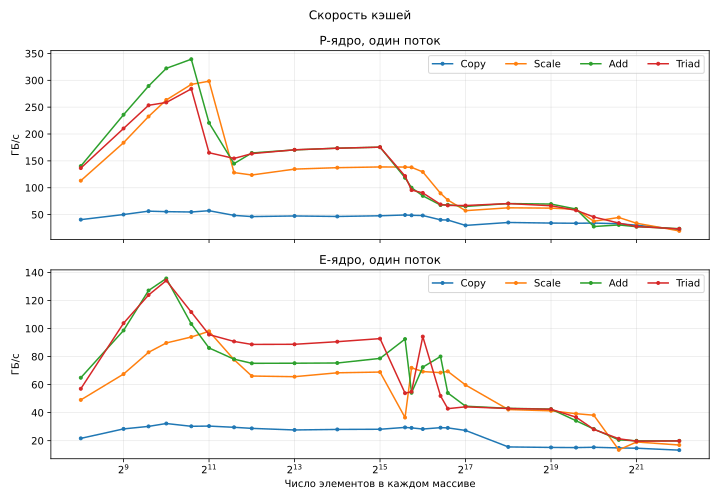
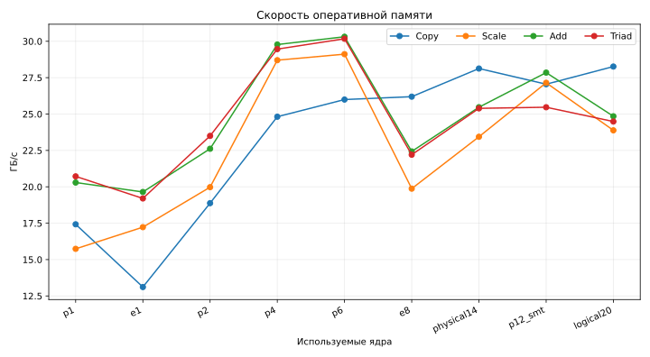

# Изучение скорости памяти с помощью теста STREAM

Студент: Пирогов Александр  
Группа: 323  
Дата измерений: 14 сентября 2026 г.

## 1. Введение

Скорость программы зависит не только от процессора, но и от памяти. Если
процессор долго ждёт данные, то он не может выполнять вычисления с полной
скоростью.

Цель работы — измерить пропускную способность кэшей и оперативной памяти на
ноутбуке с процессором Intel Core i9-12900H.

Для работы использован тест STREAM. Он читает и записывает большие массивы и
показывает, сколько данных память может передать за одну секунду.

## 2. Теоретическая часть

### 2.1. Уровни памяти

В компьютере есть несколько уровней памяти.


| Уровень | Особенности                                                  |
| ------- | ------------------------------------------------------------ |
| L1      | Самый маленький и быстрый кэш. Находится рядом с ядром.      |
| L2      | Больше L1, но немного медленнее.                             |
| L3      | Общий кэш процессора. Он больше L2, но ещё медленнее.        |
| RAM     | Оперативная память. Она большая, но намного медленнее кэшей. |


Когда процессору нужны данные, он сначала ищет их в L1. Если данных там нет,
он проверяет L2, затем L3 и только потом RAM. Поэтому программа работает
быстрее, если часто используемые данные помещаются в кэш.

### 2.2. Пропускная способность

Пропускная способность показывает, сколько байт память передаёт за секунду:

`B = V / t`,

где `B` — пропускная способность, `V` — объём данных, `t` — время.

Пропускная способность и задержка — не одно и то же. Пропускная способность
показывает скорость передачи большого объёма данных. Задержка показывает,
сколько времени занимает одно обращение к памяти. STREAM измеряет именно
пропускную способность.

### 2.3. Как работает STREAM

STREAM использует три массива `a`, `b` и `c`. Каждый элемент имеет тип
`double` и занимает 8 байт.


| Операция | Формула                | Что делает               | Байт на элемент |
| -------- | ---------------------- | ------------------------ | --------------- |
| Copy     | `c[i] = a[i]`          | копирует данные          | 16              |
| Scale    | `b[i] = 3*c[i]`        | умножает данные на число | 16              |
| Add      | `c[i] = a[i] + b[i]`   | складывает два массива   | 24              |
| Triad    | `a[i] = b[i] + 3*c[i]` | умножает и складывает    | 24              |


Например, Copy читает 8 байт из массива `a` и записывает 8 байт в массив `c`.
Всего получается 16 байт на один элемент.

В тесте измеряется время каждого цикла. После этого число обработанных байт
делится на время. Чем больше результат в ГБ/с, тем быстрее работает память.

### 2.4. Размер массивов

Размер массивов влияет на результат. Если массивы маленькие, они помещаются в
кэш. Если массивы большие, процессору приходится обращаться к RAM.

Общий размер трёх массивов равен:

`M = 3 · N · 8 = 24N байт`,

где `N` — число элементов в каждом массиве.

Для проверки RAM один массив должен быть как минимум в четыре раза больше
общего кэша последнего уровня. В этом процессоре L3 равен 24 МиБ. Поэтому
минимальный размер одного массива равен 96 МиБ, или 12 582 912 элементов
`double`.

В полном тесте использовано `N = 67 108 864`:

- один массив занимает 512 МиБ;
- три массива занимают 1,5 ГиБ;
- такой объём намного больше кэша L3.

Для изучения кэшей размер `N` постепенно менялся. Пока данные помещаются в
кэш, скорость высокая. После выхода за границу кэша скорость уменьшается.

### 2.5. Теоретическая скорость RAM

В ноутбуке установлен один модуль DDR5-4800 с шириной шины 64 бита, то есть
8 байт. Теоретическая скорость равна:

`4800 · 10^6 · 8 = 38,4 · 10^9 байт/с = 38,4 ГБ/с`.

На практике результат всегда меньше. Часть времени тратится на управление
памятью, обновление ячеек, работу операционной системы и другие задачи. Также
на результат влияют температура и частота процессора.

### 2.6. Потоки и типы ядер

Intel Core i9-12900H имеет два типа ядер:

- P-ядра — быстрые ядра для тяжёлых задач;
- E-ядра — более простые и экономичные ядра.

Увеличение числа потоков ускоряет тест только до тех пор, пока канал памяти не
будет заполнен. После этого дополнительные потоки почти не помогают. Иногда
они даже уменьшают результат из-за конкуренции за память.

## 3. Оборудование


| Компонент            | Значение                                              |
| -------------------- | ----------------------------------------------------- |
| Ноутбук              | ASUS ROG Strix G733ZW                                 |
| Процессор            | Intel Core i9-12900H                                  |
| Ядра                 | 6 P-ядер и 8 E-ядер, всего 20 логических процессоров  |
| Кэш P-ядер           | L1D 48 КиБ, L2 1280 КиБ на ядро                       |
| Кэш E-ядер           | L1D 32 КиБ, L2 2 МиБ на кластер                       |
| Общий кэш            | L3 24 МиБ                                             |
| Оперативная память   | 1 × 16 ГиБ DDR5-4800                                  |
| Операционная система | Windows 11 x64                                        |
| Компилятор           | Microsoft C++ с оптимизацией `/O2 /arch:AVX2 /openmp` |


## 4. Программа и порядок работы

Программа сделана на C++ и Python.

- [src/stream.cpp](src/stream.cpp) выполняет четыре операции STREAM и измеряет
время.
- [run.py](run.py) собирает C++-программу, запускает тесты и строит графики.

Длины массивов записаны в начале `run.py`. Для RAM используется
`N = 67 108 864`, а размеры для проверки кэшей находятся в списке
`CACHE_SIZES`. Python передаёт выбранную длину в C++-программу первым
параметром.

В начале C++-программа создаёт три массива длины `N` и заполняет их обычным
циклом: `a = 1`, `b = 2`, `c = 0`.

Порядок работы программы:

1. Создать три массива.
2. Заполнить их начальными значениями.
3. Один раз выполнить операцию для прогрева памяти.
4. Несколько раз измерить скорость.
5. Найти медианный результат.
6. Проверить правильность значений в массивах.
7. Записать результаты в CSV и построить графики.

Для запуска нужны Python, библиотека `matplotlib` и компилятор C++:

```powershell
py -m pip install -r requirements.txt
py run.py
```


## 5. Результаты

Графики ниже берутся из файлов в папке `results`. При каждом запуске команда
`py run.py` выполняет полный тест, заменяет CSV и сразу строит новые графики.

### 5.1. Скорость кэшей

В таблице показана скорость одного потока, ГБ/с.


| Ядро | Уровень | N         | Copy   | Scale  | Add    | Triad  |
| ---- | ------- | --------- | ------ | ------ | ------ | ------ |
| P    | L1      | 1 024     | 258,90 | 408,49 | 332,82 | 319,09 |
| P    | L2      | 32 768    | 107,48 | 114,33 | 146,70 | 149,35 |
| P    | L3      | 524 288   | 53,72  | 59,62  | 65,60  | 64,84  |
| P    | RAM     | 4 194 304 | 19,01  | 19,71  | 22,41  | 22,07  |
| E    | L1      | 1 024     | 110,39 | 117,38 | 171,92 | 168,91 |
| E    | L2      | 65 536    | 75,78  | 75,38  | 92,50  | 53,81  |
| E    | L3      | 524 288   | 41,82  | 41,63  | 42,27  | 39,45  |
| E    | RAM     | 4 194 304 | 12,94  | 16,37  | 19,22  | 18,83  |




Скорость уменьшается при переходе от L1 к L2, затем к L3 и RAM. P-ядро почти
во всех случаях быстрее E-ядра. Это совпадает с теорией: маленький кэш ближе к
ядру и работает быстрее большой памяти.

### 5.2. Скорость оперативной памяти

В таблице показана скорость RAM, ГБ/с.


| Конфигурация   | Потоки | Copy      | Scale     | Add       | Triad     |
| -------------- | ------ | --------- | --------- | --------- | --------- |
| P1             | 1      | 25,14     | 17,94     | 21,00     | 21,03     |
| E1             | 1      | 16,92     | 16,99     | 19,33     | 19,44     |
| P2             | 2      | 28,97     | 19,94     | 23,14     | 23,06     |
| P4             | 4      | **30,26** | 29,08     | **30,07** | 29,74     |
| P6             | 6      | 30,22     | **29,70** | 29,97     | **29,87** |
| E8             | 8      | 29,25     | 19,62     | 22,00     | 22,15     |
| Все физические | 14     | 29,30     | 24,41     | 25,45     | 25,17     |
| P-ядра с SMT   | 12     | 29,66     | 28,60     | 28,68     | 28,31     |
| Все логические | 20     | 28,83     | 24,17     | 24,89     | 24,64     |




Лучший средний результат получен на шести P-ядрах и равен примерно
29,94 ГБ/с. Отношение к теоретической скорости:

`29,94 / 38,4 · 100 % ≈ 78 %`.

Четырёх-шести P-ядер уже достаточно для заполнения канала памяти. Большее
число потоков не увеличило скорость. Совместная работа P- и E-ядер дала менее
ровный результат, потому что эти ядра имеют разную производительность.

## 6. Возможные погрешности

На измерения могли повлиять:

- фоновые программы Windows;
- изменение частоты процессора;
- нагрев ноутбука;
- работа антивируса;
- общий кэш L3, который используют все ядра;
- небольшая разница между отдельными запусками.

Чтобы уменьшить погрешность, каждый тест выполнялся несколько раз. В отчёт
записана медиана, а перед измерением выполнялся прогрев.

## 7. Вывод

В работе была изучена пропускная способность памяти ноутбука. Результаты
показали, что кэш L1 работает быстрее L2, L2 быстрее L3, а L3 быстрее RAM.
P-ядра оказались быстрее E-ядер при работе с кэшем.

Максимальная скорость оперативной памяти составила около 30 ГБ/с. Это примерно
78 % от теоретических 38,4 ГБ/с. Канал памяти заполняется уже при использовании
4–6 P-ядер, поэтому дальнейшее увеличение числа потоков почти не помогает.

Главный практический вывод: программе полезно обрабатывать данные небольшими
блоками, которые помещаются в кэш. Это может дать больший эффект, чем простое
добавление новых потоков.

## 8. Файлы и источники

- [results/cache_results.csv](results/cache_results.csv) — результаты для кэшей;
- [results/ram_results.csv](results/ram_results.csv) — результаты для RAM;
- [results/cache_sweep.svg](results/cache_sweep.svg) — график кэшей;
- [results/ram_scaling.svg](results/ram_scaling.svg) — график RAM;
- [официальная страница STREAM](https://www.cs.virginia.edu/stream/);
- [описание Intel Core i9-12900H](https://www.intel.com/content/www/us/en/products/sku/132214/).

