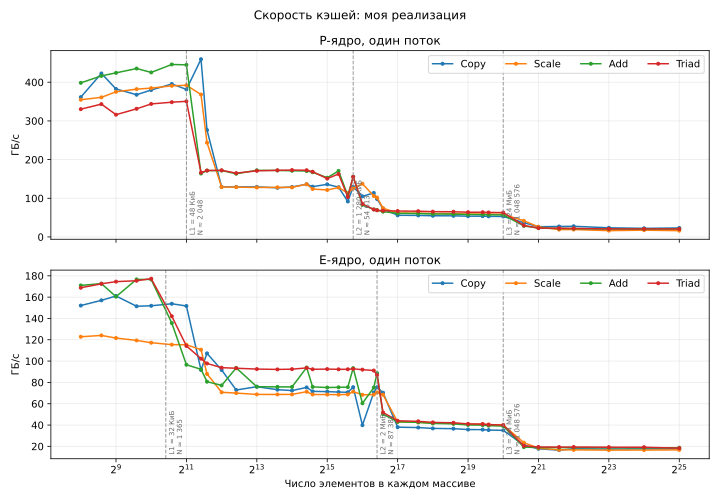
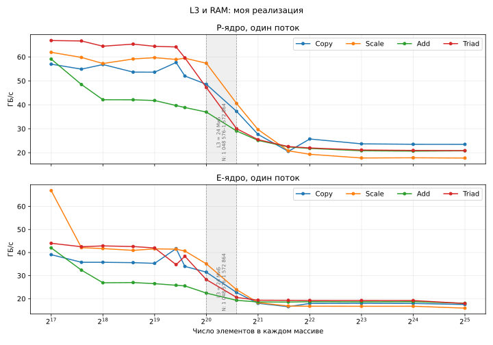
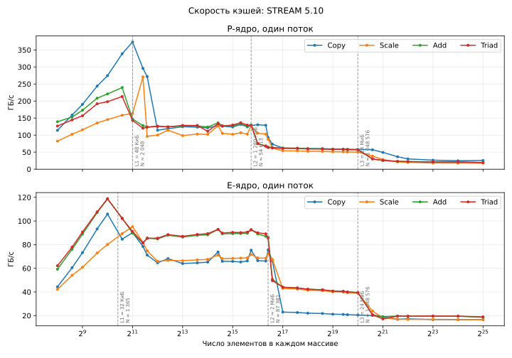
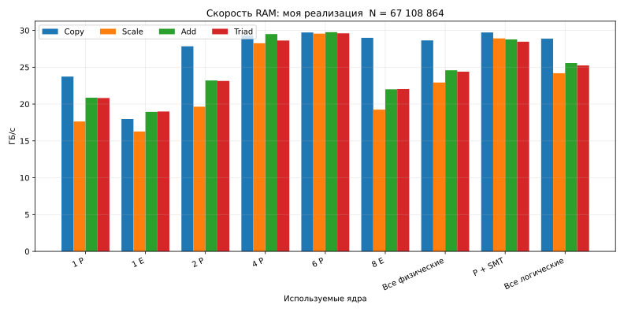
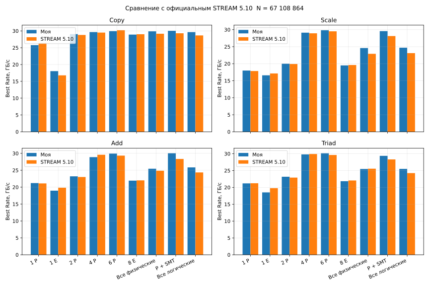

# Изучение скорости памяти с помощью теста STREAM

Студент: Пирогов Александр  
Группа: 323

## 1. Введение

Скорость программы зависит не только от процессора, но и от памяти. Если
процессор долго ждёт данные, то он не может выполнять вычисления с полной
скоростью.

Цель работы — измерить пропускную способность кэшей и оперативной памяти на
ноутбуке с процессором Intel Core i9-12900H.

Для работы использован тест STREAM. Он читает и записывает большие массивы и
показывает, сколько данных память может передать за одну секунду.

## 2. Теоретическая часть

### 2.1. Уровни памяти

В компьютере есть несколько уровней памяти.


| Уровень | Особенности                                                  |
| ------- | ------------------------------------------------------------ |
| L1      | Самый маленький и быстрый кэш. Находится рядом с ядром.      |
| L2      | Больше L1, но немного медленнее.                             |
| L3      | Общий кэш процессора. Он больше L2, но ещё медленнее.        |
| RAM     | Оперативная память. Она большая, но намного медленнее кэшей. |


Когда процессору нужны данные, он сначала ищет их в L1. Если данных там нет,
он проверяет L2, затем L3 и только потом RAM. Поэтому программа работает
быстрее, если часто используемые данные помещаются в кэш.

### 2.2. Пропускная способность

Пропускная способность показывает, сколько байт память передаёт за секунду:

`B = V / t`,

где `B` — пропускная способность, `V` — объём данных, `t` — время.

Пропускная способность и задержка — не одно и то же. Пропускная способность
показывает скорость передачи большого объёма данных. Задержка показывает,
сколько времени занимает одно обращение к памяти. STREAM измеряет именно
пропускную способность.

### 2.3. Как работает STREAM

STREAM использует три массива `a`, `b` и `c`. Каждый элемент имеет тип
`double` и занимает 8 байт.


| Операция | Формула                | Что делает               | Байт на элемент |
| -------- | ---------------------- | ------------------------ | --------------- |
| Copy     | `c[i] = a[i]`          | копирует данные          | 16              |
| Scale    | `b[i] = 3*c[i]`        | умножает данные на число | 16              |
| Add      | `c[i] = a[i] + b[i]`   | складывает два массива   | 24              |
| Triad    | `a[i] = b[i] + 3*c[i]` | умножает и складывает    | 24              |


Например, Copy читает 8 байт из массива `a` и записывает 8 байт в массив `c`.
Всего получается 16 байт на один элемент.

В тесте измеряется время каждого цикла. После этого число обработанных байт
делится на время. Чем больше результат в ГБ/с, тем быстрее работает память.

### 2.4. Размер массивов

Размер массивов влияет на результат. Если массивы маленькие, они помещаются в
кэш. Если массивы большие, процессору приходится обращаться к RAM.

Общий размер трёх массивов равен:

`M = 3 · N · 8 = 24N байт`,

где `N` — число элементов в каждом массиве.

Для проверки RAM один массив должен быть как минимум в четыре раза больше
общего кэша последнего уровня. В этом процессоре L3 равен 24 МиБ. Поэтому
минимальный размер одного массива равен 96 МиБ, или 12 582 912 элементов
`double`.

В полном тесте использовано `N = 67 108 864`:

- один массив занимает 512 МБ;
- три массива занимают 1,5 ГБ;
- такой объём намного больше кэша L3.

Для изучения кэшей размер `N` постепенно менялся. Пока данные помещаются в
кэш, скорость высокая. После выхода за границу кэша скорость уменьшается.

### 2.5. Теоретическая скорость RAM

В ноутбуке установлен один модуль DDR5-4800 с шириной шины 64 бита, то есть
8 байт. Теоретическая скорость равна:

`4800 · 10^6 · 8 = 38,4 · 10^9 байт/с = 38,4 ГБ/с`.

На практике результат всегда меньше. Часть времени тратится на управление
памятью, обновление ячеек, работу операционной системы и другие задачи. Также
на результат влияют температура и частота процессора.

### 2.6. Потоки и типы ядер

Intel Core i9-12900H имеет два типа ядер:

- P-ядра — быстрые ядра для тяжёлых задач;
- E-ядра — более простые и экономичные ядра.

Увеличение числа потоков ускоряет тест только до тех пор, пока канал памяти не
будет заполнен. После этого дополнительные потоки почти не помогают. Иногда
они даже уменьшают результат из-за конкуренции за память.

## 3. Оборудование


| Компонент            | Значение                                              |
| -------------------- | ----------------------------------------------------- |
| Ноутбук              | ASUS ROG Strix G733ZW                                 |
| Процессор            | Intel Core i9-12900H                                  |
| Ядра                 | 6 P-ядер и 8 E-ядер, всего 20 логических процессоров  |
| Кэш P-ядер           | L1D 48 КиБ, L2 1280 КиБ на ядро                       |
| Кэш E-ядер           | L1D 32 КиБ, L2 2 МиБ на кластер                       |
| Общий кэш            | L3 24 МиБ                                             |
| Оперативная память   | 1 × 16 ГиБ DDR5-4800                                  |
| Операционная система | Windows 11 x64                                        |
| Компилятор           | Microsoft C++ с оптимизацией `/O2 /arch:AVX2 /openmp` |


## 4. Программа и порядок работы

Программа сделана на C++ и Python.

- [my_stream/stream.cpp](my_stream/stream.cpp) содержит мою реализацию STREAM.
- [my_stream/run.py](my_stream/run.py) собирает и запускает только мою версию.
- [official_stream/stream.c](official_stream/stream.c) содержит неизменённый STREAM 5.10.
- [official_stream/run.py](official_stream/run.py) собирает и запускает официальную версию.
- [run.py](run.py) по очереди запускает все замеры обеих версий.
- [plot.py](plot.py) отдельно строит графики по готовым CSV.
- [make_presentation.py](make_presentation.py) отдельно создаёт PDF.

Длины массивов записаны в `my_stream/run.py` и `official_stream/run.py`.
В список входят 39 размеров для кэшей и `N = 67 108 864` для RAM. Python
перебирает все 40 значений `N` на каждой из 9 конфигураций ядер и передаёт
выбранную длину в C++-программу первым параметром. Сам C++ не хранит список
размеров и выполняет только один переданный ему вариант.

В начале C++-программа создаёт один большой блок памяти. В нём
размещаются три массива `a`, `b` и `c` длины `N`. Начало каждого массива
выровнено по границе 64 байта. Между массивами оставлено ещё 64 байта.
Затем они заполняются обычным циклом: `a = 1`, `b = 2`, `c = 0`.

Для любого числа потоков используется один и тот же OpenMP-код. Одна
параллельная область работает сразу во всех `repeats`, поэтому между повторами
нет барьеров. Каждый поток получает свой непрерывный участок массива, а границы
участков совпадают с границами строк кэша. Это убирает ложное совместное
использование строки кэша соседними потоками.

Windows-версия Copy за один шаг переносит четыре AVX2-вектора, то есть 16 чисел
`double`. Для размеров меньше 4 194 304 используются обычные AVX2-записи, а для
больших массивов — потоковые записи и `sfence`. Поэтому компилятор не заменяет
этот код отдельным вызовом `memcpy`.

Порядок работы программы:

1. Создать три массива.
2. Заполнить их начальными значениями.
3. Один раз выполнить операцию для прогрева памяти.
4. Несколько раз измерить скорость.
5. Найти медианный результат.
6. Проверить правильность значений в массивах.
7. Записать результаты в CSV.
8. Отдельным запуском `plot.py` построить графики.

Для каждой строки обеих реализаций измерение продолжается не меньше 2 секунд.
Если заданного числа измерений недостаточно, программа автоматически добавляет
новые. В CSV сохраняются суммарное время, объём обработанных данных, медианное и
лучшее время.

Для сравнения официальный STREAM для каждого `N` собирается с OpenMP и AVX2.
Небольшой Windows-адаптер задаёт число потоков, affinity и время измерения, но
не меняет официальные ядра Copy, Scale, Add и Triad.

Для запуска нужны Python, библиотека `matplotlib` и компилятор C++:

```powershell
py -m pip install -r requirements.txt
py run.py
py plot.py
py make_presentation.py
```


## 5. Результаты

Мои результаты записываются в `my_stream/results`, а официальные — в
`official_stream/results`. Команда `py run.py` создаёт CSV, но не строит графики.
Графики создаются отдельной командой `py plot.py`.

### 5.1. Скорость кэшей

В таблице показана скорость одного потока, ГБ/с.

Примечание: числа и графики в этой версии отчёта относятся к последнему полному
прогону с обычным Copy через `memcpy`. После возврата AVX2 контрольный тест дал
346,93 ГБ/с при `N = 256` и 378,22 ГБ/с при `N = 1024`. Полные таблицы будут
заменены следующим запуском `py run.py`.


| Ядро | Уровень | N         | Copy  | Scale  | Add    | Triad  |
| ---- | ------- | --------- | ----- | ------ | ------ | ------ |
| P    | L1      | 1 024     | 60,78 | 370,34 | 388,39 | 353,68 |
| P    | L2      | 32 768    | 47,54 | 127,77 | 171,92 | 172,73 |
| P    | L3      | 524 288   | 33,07 | 60,42  | 51,92  | 64,17  |
| P    | RAM     | 4 194 304 | 19,37 | 18,98  | 21,52  | 21,49  |
| E    | L1      | 1 024     | 35,42 | 118,34 | 176,52 | 176,10 |
| E    | L2      | 65 536    | 26,02 | 68,05  | 62,80  | 91,36  |
| E    | L3      | 524 288   | 13,87 | 40,04  | 27,54  | 40,68  |
| E    | RAM     | 4 194 304 | 11,85 | 16,35  | 18,28  | 19,02  |




Ниже та же однопоточная серия без больших значений L1 и L2. Поэтому различия
между операциями в L3 и RAM видны подробнее.



Для проверки отдельно измерены неизменённые циклы официального STREAM 5.10 с
таким же временем измерения и на тех же P- и E-ядрах.



Скорость уменьшается при переходе от L1 к L2, затем к L3 и RAM. P-ядро почти
во всех случаях быстрее E-ядра. Это совпадает с теорией: маленький кэш ближе к
ядру и работает быстрее большой памяти. Официальный STREAM тоже показывает
рост на самых маленьких массивах и отдельные зубцы около границ кэша.

### 5.2. Скорость оперативной памяти

В таблице показана скорость RAM, ГБ/с.


| Конфигурация   | Потоки | Copy  | Scale | Add   | Triad |
| -------------- | ------ | ----- | ----- | ----- | ----- |
| P1             | 1      | 24,59 | 17,66 | 20,90 | 20,56 |
| E1             | 1      | 18,06 | 16,73 | 19,02 | 19,22 |
| P2             | 2      | 27,83 | 19,28 | 22,19 | 22,67 |
| P4             | 4      | 28,86 | 27,87 | 28,50 | 28,55 |
| P6             | 6      | 29,63 | 28,38 | 27,43 | 28,57 |
| E8             | 8      | 27,50 | 18,71 | 21,11 | 21,25 |
| Все физические | 14     | 28,81 | 22,14 | 24,08 | 23,72 |
| P-ядра с SMT   | 12     | 28,65 | 26,67 | 26,90 | 26,98 |
| Все логические | 20     | 29,06 | 23,58 | 24,69 | 24,53 |




Лучшие результаты получены на четырёх-шести P-ядрах и составляют примерно
30 ГБ/с. Отношение к теоретической скорости:

`30 / 38,4 · 100 % ≈ 78 %`.

Четырёх-шести P-ядер уже достаточно для заполнения канала памяти. Большее
число потоков не увеличило скорость. Совместная работа P- и E-ядер дала менее
ровный результат, потому что эти ядра имеют разную производительность.

### 5.3. Сравнение с официальным STREAM 5.10

Для честного сравнения используются `Best Rate` обеих программ.


| Операция | Среднее отличие моей версии от STREAM 5.10 | Наибольшее отличие |
| -------- | ------------------------------------------ | ------------------ |
| Copy     | +1,5 %                                     | 9,9 %              |
| Scale    | +0,3 %                                     | 3,9 %              |
| Add      | −0,9 %                                     | 3,0 %              |
| Triad    | −0,7 %                                     | 3,1 %              |




После нового полного прогона результаты двух реализаций почти совпали. Среднее
отличие Scale, Add и Triad меньше одного процента, а у Copy моя AVX2-версия в
среднем на 1,5 % быстрее. Самое большое отличие Copy относится к отдельной
конфигурации, а не ко всем измерениям сразу.

### 5.4. Объяснение особенностей кэш-графика

1. Прежний сильный рост скорости на малых `N` в основном давал OpenMP. При
   одном потоке каждый короткий цикл всё равно запускал OpenMP-область. Теперь для
   одного потока используется обычный цикл. На P-ядре Add равен 382,83; 388,39 и
   407,96 ГБ/с при `N = 256`, `1024` и `2048`. Кривая стала намного ровнее. Небольшой
   оставшийся рост могут давать цена короткого цикла, изменение частоты CPU и
   работа предвыборки данных.
2. Район `2^16` совпадает с границей L2. Для P-ядра Add/Triad перестают
  помещаться в L2 примерно при `N = 54 613`, а Copy/Scale — при `N = 81 920`.
   Поэтому общий спад ожидаем. Отдельные резкие зубцы возникают из-за
   отображения массивов в наборы кэша, общего E-core L2, фоновой работы ОС и
   изменения частоты.
   Новые промежуточные точки показывают, что это не один случайный провал. Например,
   у P-ядра Add меняется от 154,51 ГБ/с при `N = 49 152` до 81,36 при `N = 54 613`.
   Затем при `N = 65 536` получается 84,22 ГБ/с. Значит, основная ступень связана
   с заполнением L2, хотя небольшие зубцы внутри неё могут меняться между запусками.
3. На графике кэшей используется ровно один поток; там сравниваются типы P и E,
  а не число ядер. На графике RAM показана суммарная полоса всех потоков, и она
   должна расти от одного до нескольких ядер, пока канал памяти не насытится.
   На этом ноутбуке насыщение происходит примерно на 4–6 P-ядрах.
4. Copy и Scale считают одинаковые 16 байт на элемент. Вариант через `memcpy`
   показывал только 55,58 ГБ/с при `N = 256`. После возврата явного AVX2 Copy
   показывает 346,93 ГБ/с, а Scale — 332,19 ГБ/с. При `N = 1024` получено 378,22
   и 371,04 ГБ/с. Add и Triad считают по 24 байта на элемент, поэтому их значения
   в ГБ/с нельзя сравнивать как время выполнения одного цикла.


## 6. Возможные погрешности

На измерения могли повлиять:

- фоновые программы Windows;
- изменение частоты процессора;
- нагрев ноутбука;
- работа антивируса;
- общий кэш L3, который используют все ядра;
- небольшая разница между отдельными запусками.

Чтобы уменьшить погрешность, каждый тест выполнялся несколько раз. В отчёт
записана медиана, а перед измерением выполнялся прогрев.

## 7. Вывод

В работе была изучена пропускная способность памяти ноутбука. Результаты
показали, что кэш L1 работает быстрее L2, L2 быстрее L3, а L3 быстрее RAM.
P-ядра оказались быстрее E-ядер при работе с кэшем.

Максимальная скорость оперативной памяти составила около 30 ГБ/с. Это примерно
78 % от теоретических 38,4 ГБ/с. Канал памяти заполняется уже при использовании
4–6 P-ядер, поэтому дальнейшее увеличение числа потоков почти не помогает.

Главный практический вывод: программе полезно обрабатывать данные небольшими
блоками, которые помещаются в кэш. Это может дать больший эффект, чем простое
добавление новых потоков.

## 8. Файлы и источники

- [my_stream/results/all_results.csv](my_stream/results/all_results.csv) — все размеры и
  конфигурации моей реализации;
- [official_stream/results/all_results.csv](official_stream/results/all_results.csv) — все
  размеры и конфигурации STREAM 5.10;
- [my_stream/results/cache_results.csv](my_stream/results/cache_results.csv) — мои кэши;
- [official_stream/results/cache_results.csv](official_stream/results/cache_results.csv) —
  кэши официального STREAM 5.10;
- [my_stream/results/ram_results.csv](my_stream/results/ram_results.csv) — мои результаты RAM;
- [official_stream/results/ram_results.csv](official_stream/results/ram_results.csv) —
  официальный STREAM 5.10;
- [results/ram_comparison.csv](results/ram_comparison.csv) — сравнение;
- [my_stream/results/cache_sweep.svg](my_stream/results/cache_sweep.svg) — мой график кэшей;
- [my_stream/results/all_profiles.svg](my_stream/results/all_profiles.svg) — все размеры и
  конфигурации моей реализации;
- [my_stream/results/cache_ram_zoom.svg](my_stream/results/cache_ram_zoom.svg) — увеличенная
  часть графика для L3 и RAM;
- [official_stream/results/cache_sweep.svg](official_stream/results/cache_sweep.svg) — график
  кэшей официального STREAM 5.10;
- [official_stream/results/all_profiles.svg](official_stream/results/all_profiles.svg) — все
  размеры и конфигурации официального STREAM;
- [my_stream/results/ram_scaling.svg](my_stream/results/ram_scaling.svg) — мой график RAM;
- [official_stream/results/ram_scaling.svg](official_stream/results/ram_scaling.svg) — график RAM STREAM 5.10;
- [results/ram_comparison.svg](results/ram_comparison.svg) — график сравнения;
- [my_stream/results/instruction_audit.txt](my_stream/results/instruction_audit.txt) — проверка
машинного кода;
- [официальная страница STREAM](https://www.cs.virginia.edu/stream/);
- [описание Intel Core i9-12900H](https://www.intel.com/content/www/us/en/products/sku/132214/).
